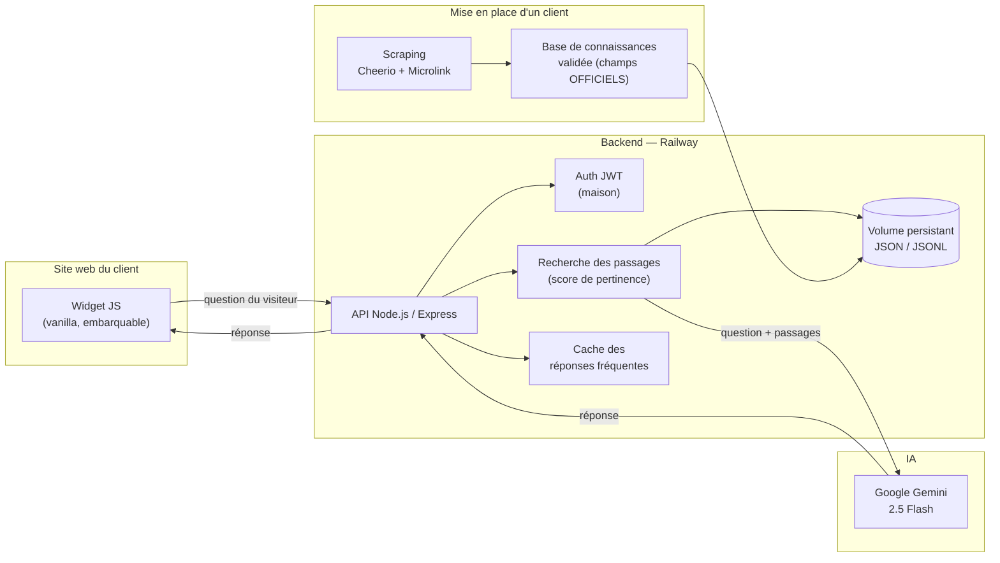
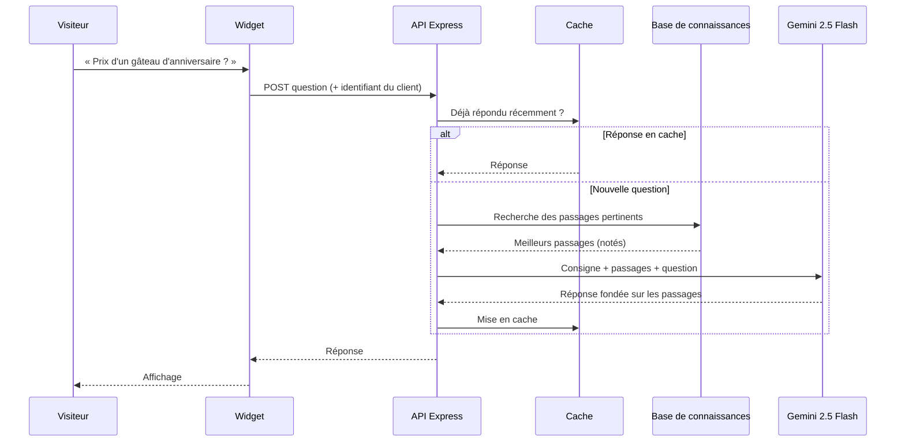

# 🤖 Chatbot IA Novyxs — architecture et fonctionnement

> **Étude de cas technique.** Ce dépôt explique comment j'ai conçu, construit et déployé la plateforme de chatbots IA de [Novyxs](https://novyxs.com), ma compagnie.
> Le code source reste **privé** : c'est un produit commercial en exploitation chez de vrais clients. Ici, j'explique l'architecture, les choix techniques et les contraintes, sans le code.

**Auteur :** Amine Meliouh, fondateur de Novyxs · Montréal
**Statut :** en production chez des clients (PME de la Rive-Sud de Montréal)

---

## 1. Le problème

Les petites entreprises (ateliers de réparation, boutiques, commerces locaux) reçoivent sans arrêt les mêmes questions : *« Vous êtes ouverts quand ? », « Combien coûte… ? », « Vous livrez où ? »*. Elles n'ont pas les moyens de payer quelqu'un pour répondre 24 h sur 24 et 7 jours sur 7. Les chatbots génériques, eux, **inventent des réponses**, ce qui est inacceptable quand on parle de prix ou de politiques de retour.

## 2. La solution

Un chatbot IA **installé sur le site du client avec une seule ligne de script**, qui :
- répond **uniquement** à partir des informations vérifiées de l'entreprise ;
- dit « je ne sais pas » et donne le contact de l'entreprise quand l'info n'existe pas, plutôt que d'inventer ;
- est vendu en **abonnement mensuel (SaaS)**, avec la configuration incluse.

---

## 3. Architecture globale

### Composants

| Composant | Technologie | Rôle |
|---|---|---|
| **Widget** | JavaScript vanilla | Bulle de chat ajoutée au site du client par un simple `<script>`. Aucune dépendance, donc compatible avec n'importe quel site (WordPress, Shopify, site maison…). |
| **API** | Node.js + Express | Reçoit les questions, identifie le client, orchestre la recherche et l'appel au modèle. |
| **Authentification** | JWT (implémentation maison) | Sécurise l'accès à l'API et isole chaque client. |
| **Modèle de langage** | Google Gemini 2.5 Flash | Génère la réponse finale. Choisi pour sa rapidité et son faible coût par requête, deux critères essentiels pour un SaaS destiné aux PME. |
| **Stockage** | Fichiers JSON / JSONL sur un volume persistant | Bases de connaissances, configuration des clients et historique des conversations. |
| **Ingestion** | Cheerio + Microlink | Récupère le contenu du site du client (HTML statique avec Cheerio ; Microlink pour les métadonnées et les pages plus difficiles). |
| **Hébergement** | Railway (plan Hobby) | Backend toujours en ligne, avec un volume persistant. |

---

## 4. Fonctionnement d'une question, étape par étape

1. **Crawl** : à la mise en place d'un client, je récupère le contenu de son site.
2. **Découpage (chunks)** : le contenu est divisé en petits passages autonomes, par exemple « Heures : du mardi au samedi… ».
3. **Validation** : je structure et je vérifie manuellement l'information clé (heures, prix, services, politiques, zones desservies, modes de paiement) dans des **champs « OFFICIELS »**. C'est la source de vérité du bot. J'ajoute à la main ce qui manque sur le site, comme des heures d'ouverture absentes.
4. **Recherche** : pour chaque question, les passages sont notés selon leur pertinence et seuls les meilleurs sont gardés.
5. **Génération** : Gemini reçoit une consigne stricte, les passages retenus et la question. Il doit répondre **seulement** avec ces informations.
6. **Repli** : si aucun passage n'est pertinent, le bot le dit et redirige vers le téléphone ou le courriel de l'entreprise.
7. **Cache** : une question déjà posée reçoit une réponse instantanée, sans nouvel appel au modèle.

👉 **Démo interactive** de ce pipeline sur mon portfolio : [aminemelh.github.io/portfolio-amine](https://aminemelh.github.io/portfolio-amine/)

---

## 5. Contraintes et décisions techniques

### Fiabilité avant tout : zéro invention
Une fausse réponse sur un prix ou une politique de retour coûte plus cher au client que pas de réponse du tout. C'est pour ça que tout repose sur la recherche de passages (RAG) avec une consigne stricte, une base de connaissances vérifiée par un humain et un repli explicite vers l'entreprise.

### Coût par conversation
Les PME paient un abonnement modeste, donc chaque appel au modèle compte. Pour garder les coûts bas :
- un modèle **Flash**, rapide et économique ;
- une sélection de **quelques passages seulement**, pour un contexte court et moins de jetons ;
- un **cache** pour les questions répétitives, qui sont la majorité.

### Stockage en fichiers JSON / JSONL plutôt qu'une base de données
Pour le volume actuel (quelques clients, des bases de connaissances de taille modeste), des fichiers sur un volume persistant sont **simples, rapides et quasiment gratuits** :
- JSON pour la configuration et les bases de connaissances ;
- JSONL (une ligne par événement) pour les journaux de conversation, faciles à ajouter et à analyser.

*Compromis assumé :* ce choix devra évoluer vers une vraie base de données quand le nombre de clients augmentera, à cause des accès concurrents, des requêtes et des sauvegardes.

### Widget sans framework
Le widget s'insère dans des sites dont je ne contrôle pas le code. En JavaScript vanilla, il reste léger et n'entre pas en conflit avec les librairies du site hôte.

### Mise en place répétable
L'analyse d'un site et la création de la base de connaissances suivent un **processus standardisé**, ce qui me permet de configurer un nouveau client rapidement et de façon uniforme.

---

## 6. Autour du produit (opérations)

| Domaine | Outils |
|---|---|
| Site vitrine | React + Vite, Framer Motion, hébergé sur Vercel |
| Domaine et DNS | Squarespace (enregistrements A/CNAME vers Vercel ; MX, SPF et DKIM pour le courriel) |
| Courriel pro | Zoho Mail (migré depuis Google Workspace pour réduire les coûts fixes) |
| Paiements | Stripe, Interac |
| Juridique | Contrat de service de 19 articles, conforme à la **Loi 25** du Québec sur la protection des renseignements personnels |
| Analytique | Google Analytics, Google Search Console |

---

## 7. Résultats

- Chatbots **déployés et utilisés** par des clients réels : un atelier de réparation de petits moteurs et un détaillant de cartes sportives avec deux succursales, sur la Rive-Sud de Montréal.
- Gestion **complète, seul** : conception, développement, déploiement, infrastructure, DNS, ventes, contrats et support client.

## 8. Ce que ce projet m'a appris

- Concevoir un pipeline **RAG** de bout en bout et gérer les hallucinations d'un modèle de langage.
- Penser en **coût par requête** et en **fiabilité** quand de vrais clients dépendent du système.
- Gérer l'infrastructure de production : hébergement, volumes persistants, DNS et courriel.
- Tenir compte de la **protection des données** (Loi 25) dès la conception.
- Expliquer des notions techniques à des propriétaires de PME.

## 9. Prochaines étapes

- Migrer le stockage vers une base de données relationnelle quand le nombre de clients augmentera.
- Automatiser une plus grande partie de la mise en place d'un client, du crawl à une première version de la base de connaissances.

---

📫 [LinkedIn](https://www.linkedin.com/in/amine-meliouh-31a32427a) · 🌐 [Portfolio](https://aminemelh.github.io/portfolio-amine/) · 🏢 [novyxs.com](https://novyxs.com)
